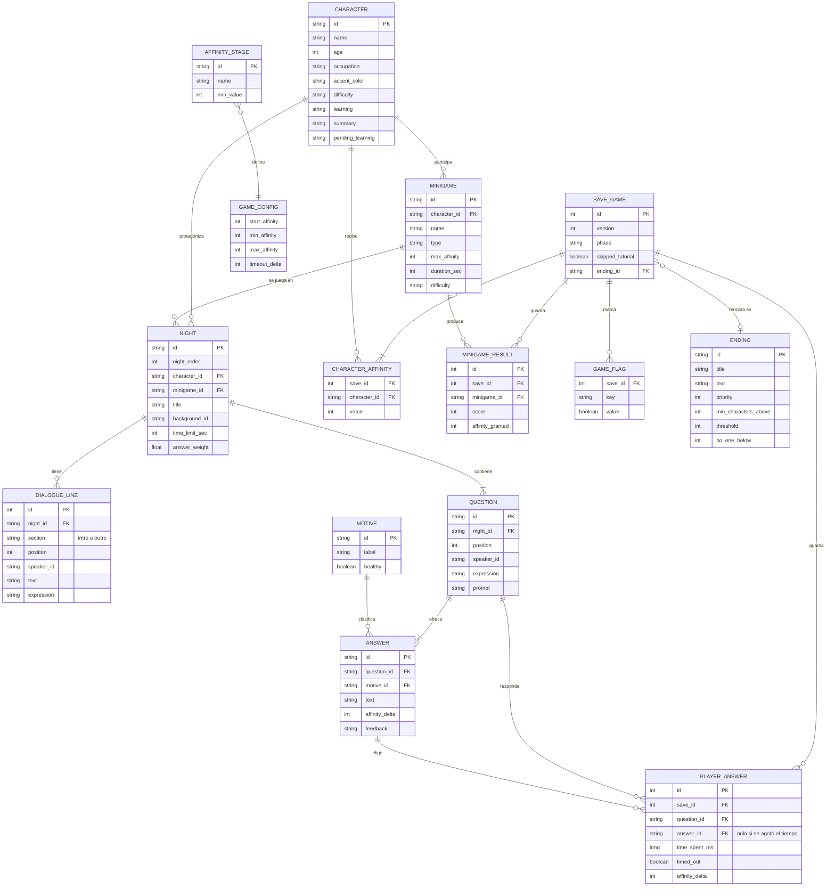

# Modelo de datos de Isla Perdida

El juego funciona 100 % sin conexión, por lo que no usa servidor. Los datos se dividen en dos bloques:

| Bloque | Qué es | Dónde vive | ¿Cambia al jugar? |
|---|---|---|---|
| **Contenido** | Personajes, noches, preguntas, respuestas, minijuegos y finales | Archivos JSON en `shared/src/commonMain/composeResources/files/` | No (solo lectura) |
| **Progreso** | Partida guardada y ajustes del jugador | Almacenamiento local del dispositivo (JSON) | Sí |

Ambos bloques se conectan por los mismos identificadores (`characterId`, `questionId`, `answerId`, `minigameId`, `endingId`). El modelo relacional completo está en [`schema.sql`](schema.sql).

## Diagrama entidad-relación

## Contenido incluido

- **3 personajes:** Valentina Oliva (dificultad moderada), Lucas Ámbar (intermedia) y Lila Ariza (elevada), a partir de la biblia de personajes.
- **3 noches:** una por personaje, cada una con introducción, 5 preguntas con 4 respuestas, un minijuego y cierre.
- **15 preguntas y 60 respuestas**, cada una con su efecto en la afinidad, el motivo que demuestra y una retroalimentación explicativa.
- **27 motivos:** 11 saludables (escucha, empatía, asertividad...) y 16 de riesgo (celos, control, minimizar, chantaje...).
- **3 minijuegos** y **3 finales** (más reglas de afinidad por etapas).

### Dificultad por noche (IP-14)

| Noche | Personaje | Tiempo por pregunta | Peso de las respuestas |
|---|---|---|---|
| 1 | Valentina | 20 s | 1.0 |
| 2 | Lucas | 15 s | 1.0 |
| 3 | Lila | 12 s | 1.2 |

### Reglas de afinidad

- Valor de 0 a 100. Cada personaje empieza en 30.
- Efecto de una respuesta = `affinityDelta × answerWeight`, redondeado y acotado a 0–100.
- Si se agota el tiempo se aplica `timeoutDelta` (-2) y la respuesta se registra como "sin respuesta".
- Un minijuego otorga afinidad proporcional a su puntaje, hasta `maxAffinity` (10 a 15). **Un minijuego por sí solo nunca llega a la afinidad necesaria para un final** (30 + 15 = 45 como máximo).
- Etapas: Desconocidos (0), Conocidos (25), Amistad (50), Cercanía (75).

### Finales (se evalúan por prioridad)

| Final | Condición |
|---|---|
| Rescatados juntos | 2 personajes o más con afinidad de 70 o más y ninguno por debajo de 40 |
| Un vínculo profundo | 1 personaje o más con afinidad de 75 o más |
| Cada quien su camino | Por defecto (siempre se cumple) |

## Checklist de relaciones sanas integrado (IP-28)

El validador de contenido (`ContentValidator`) hace cumplir el checklist de forma automática:

- Una respuesta cuyo motivo es de **riesgo** (celos, control, humillación, presión, chantaje...) **nunca puede sumar afinidad**.
- Una respuesta cuyo motivo es **saludable** nunca puede restarla.
- Los minijuegos no pueden otorgar más de 20 puntos.

Así, aunque alguien edite los JSON, el juego avisa si una escena premia una conducta tóxica.

## Cómo se relacionan contenido y progreso

1. El juego carga el contenido (`ContentRepository`) y lo valida (`ContentValidator`).
2. `ProgressRules.newGame` crea una partida con la afinidad inicial de cada personaje.
3. Cada respuesta pasa por `ProgressRules.recordAnswer` y se guarda en `SaveGame.answers`.
4. Cada minijuego pasa por `ProgressRules.recordMinigame`.
5. Al terminar la Noche 3, `ProgressRules.finish` elige el final.
6. `SaveRepository` guarda y restaura todo el `SaveGame` (IP-36).
